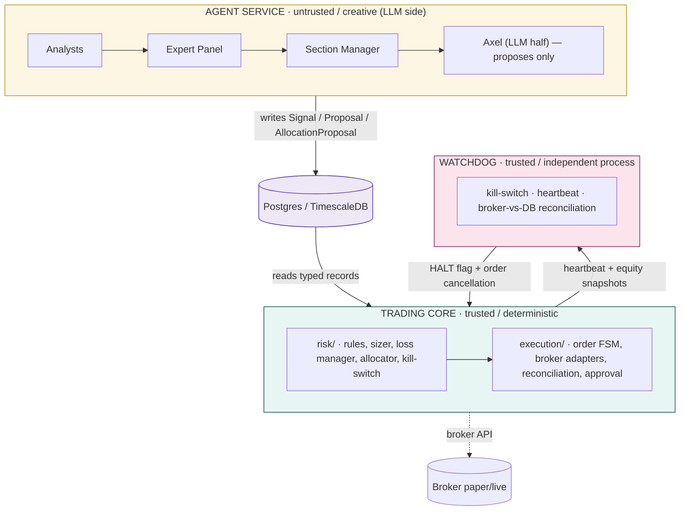
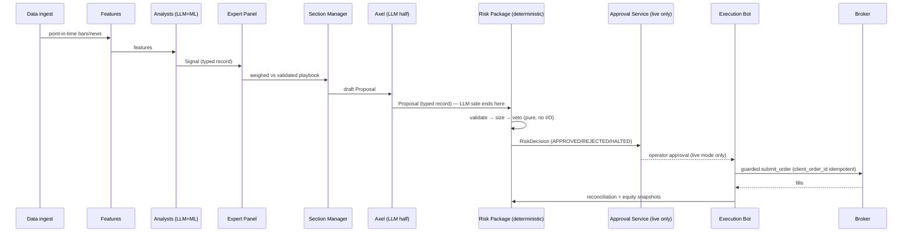
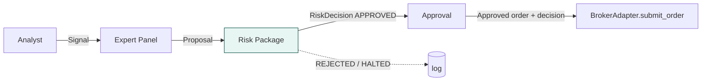
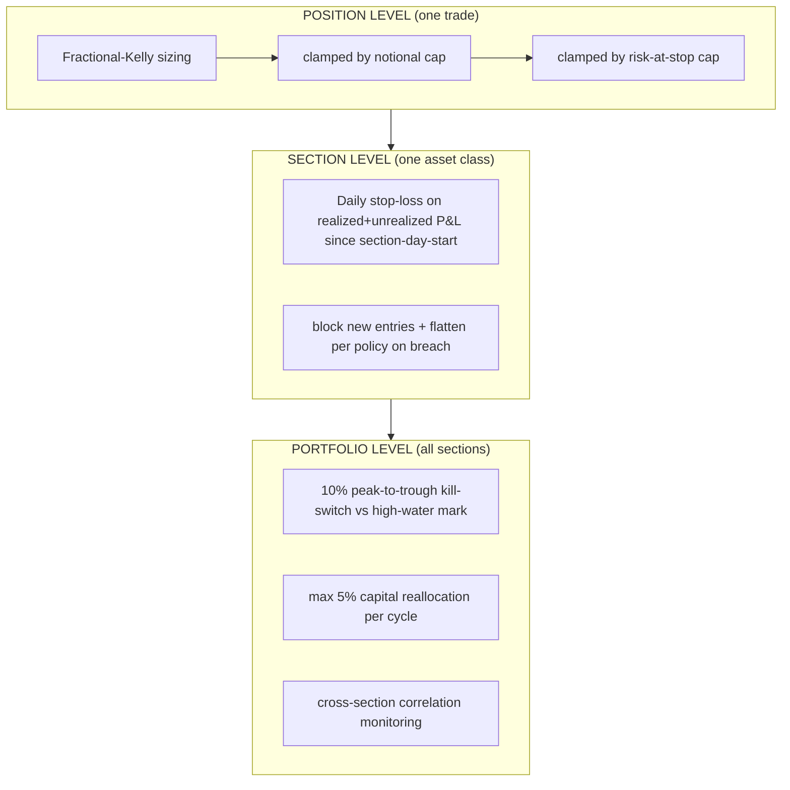
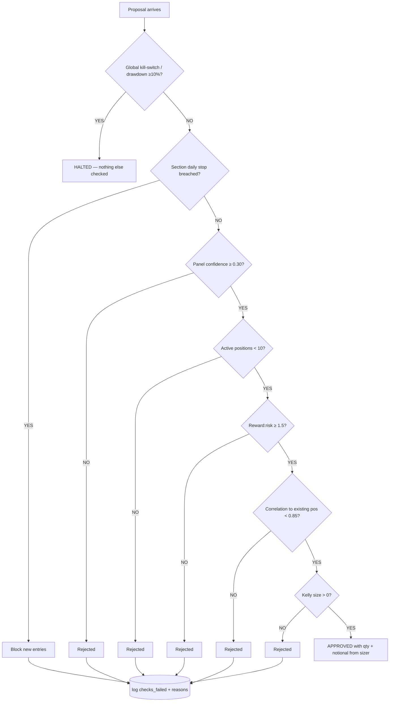
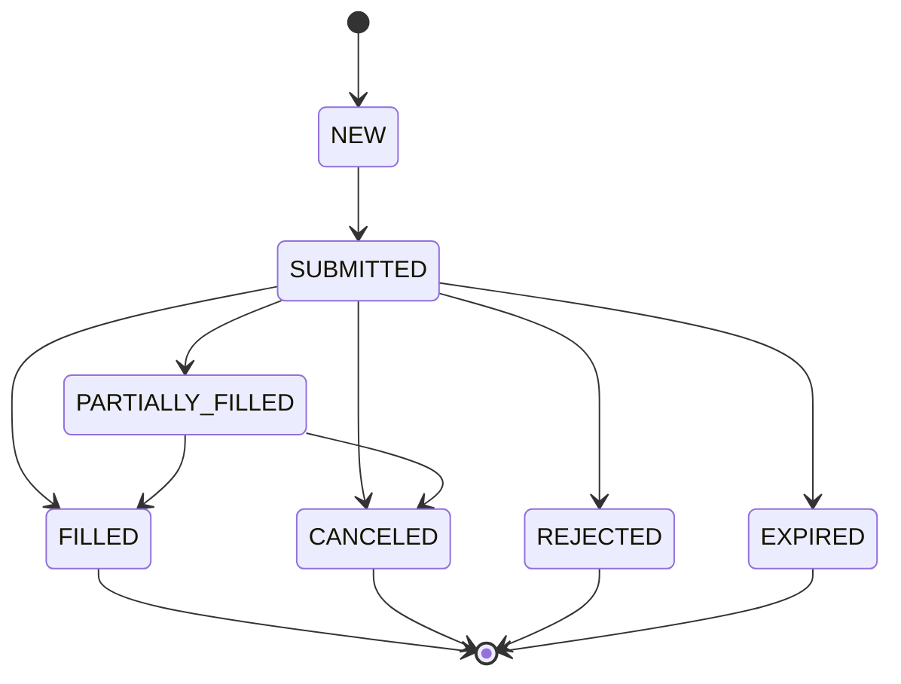
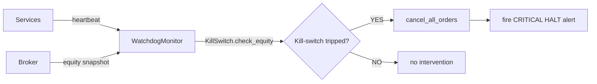
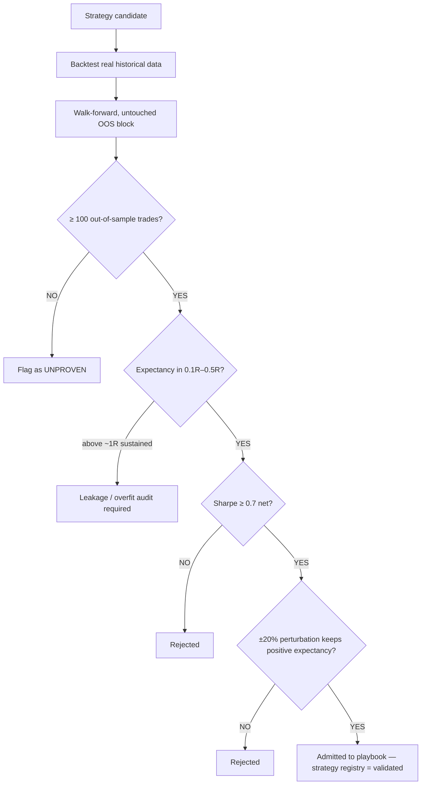
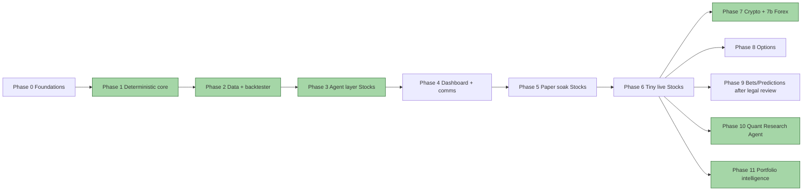

# AXEL

**Autonomous Multi-Agent Trading & Betting System** — a hierarchical agent framework that evaluates and executes trading decisions across five market sections — **Stocks, Options, Crypto, Forex, Bets/Predictions** — under a single prime overseer named *Axel*.

The full product scope is specified in [`docs/axel-v2-prd.pdf`](docs/axel-v2-prd.pdf). This README is the engineering map: what the system is, how the code is laid out, how a decision flows, and how it is kept safe.

> **Status (October 2026):** Phases 0–2 are implemented and tested. The repository also contains working verticals for Stocks (agents, paper-soak tooling and a code-complete tiny-live path), Crypto, Options research, Bets/Predictions, cross-asset portfolio intelligence (Phase 11) and the Quant Research Agent (Phase 10). The deterministic core in `axel/risk`, `axel/execution` and `axel/portfolio` is still the only authority for capital; LLM/ML code is proposal-only and CI-enforced. The full suite is **894 tests**, `ruff` is clean, and the no-LLM boundary check passes. **Live trading is not enabled:** Phase 6 is code-complete but blocked on Phase 5 paper-soak evidence, and Options/Bets remain partial/research implementations behind their written gates. See [§13](#13-roadmap-phased-build-plan) for exact per-phase status.

---

## 1. Executive summary

```text
   Analysts (LLM/ML) ──► Signals ──► Expert Panel ──► Section Manager
                                                          │  Proposal
                                                          ▼
   ─────────────────── deterministic boundary ────────────────────
                                                          │
                                               Risk Package (validate → size → veto)
                                                          │  RiskDecision (APPROVED only)
                                                          ▼
                                          Approval Service (live mode, human-in-the-loop)
                                                          │
                                                      Execution Bot ──► Broker (paper/live)
                                                          │
                                                Fills ──► Reconciliation ──► DB / Dashboard
```

Three non-negotiable principles govern every design decision:

1. **Reasoning and execution are architecturally separated and CI-enforced.** Components that call an LLM may be creative or wrong with no immediate financial consequence. Components that touch capital are deterministic, auditable, hard-coded code. A build-time lint check fails CI if an LLM library is ever imported into `risk/`, `execution/` or `portfolio/`.
2. **The trust boundary is a typed database record, never a function call.** The agent side writes `Signal`, `Proposal`, `AllocationProposal` rows; the trading core reads them. There is no code path by which agent logic can directly invoke execution logic.
3. **Nothing is trusted with capital until validated *the right way for what it is*.** Deterministic rules are backtested against real historical data. LLM judgment is validated *forward*, in paper trading, with calibration tracking — never backtested against a period the model may have memorized.

---

## 2. Architecture — three trust levels



| Trust level          | Trust | Responsibilities | Credentials | Imports |
|----------------------|-------|------------------|-------------|---------|
| **Agent service**    | Untrusted / creative | Analysts, Expert Panel, Section Manager, Axel (LLM), chat. Reads data/signals, writes only `Signal`/`Proposal`/`AllocationProposal`. | **None** | LLM/ML SDKs allowed |
| **Trading core**     | Trusted / deterministic | `risk/` (validate → size → veto), `execution/` (order FSM, adapters, reconciliation, approval), `portfolio/` (deterministic cross-asset allocation proposals). | **Trade-only, withdrawal-disabled** broker keys | LLM imports **banned by CI** |
| **Watchdog**         | Trusted / independent | Kill-switch, heartbeat liveness, broker-vs-DB reconciliation. Separate process, separate DB role, separate read access. Can cancel orders and raise a global HALT the core **must** honor. | Read-only broker access | LLM imports **banned by CI** |

### 2.1 Decision flow (one trade)



> **v2 correction:** v1 described Axel as an "LLM + deterministic hybrid" that also served as the *final trade gate*. That is a contradiction — an LLM in the last gate breaks the whole reasoning/execution separation. In v2, Axel's LLM half only emits a typed `AllocationProposal`. The actual final gate is the deterministic risk package, which validates, sizes, and can **veto every proposal with zero exceptions**.

---

## 3. Repository structure

```text
axel/                      # the AXEL package
├── core/                  # shared by every process
│   ├── types.py           #   Section, Direction, OrderSide, OrderType, OrderState, RiskVerdict …
│   ├── contracts.py       #   Signal · Proposal · RiskDecision · Order · AllocationProposal (Pydantic)
│   ├── config.py          #   AxelSettings (pydantic-settings) + live safety lock
│   ├── clock.py           #   injectable Clock / SimulatedClock (deterministic replay)
│   ├── ids.py             #   idempotent client_order_id generation
│   ├── money.py           #   Decimal money helpers
│   └── logging.py         #   structured JSON logging (one object per line)
│
├── risk/                  # DETERMINISTIC · no LLM imports (CI-enforced)
│   ├── engine.py          #   SectionRiskAgent.evaluate() — pure, priority-ordered checks
│   ├── sizer.py           #   KellySizer — fractional Kelly, layered caps, binding cap recorded
│   ├── limits.py          #   RiskLimits — frozen, immutable thresholds
│   ├── loss_manager.py    #   LossManager — daily stop, ALLOW / BLOCK_NEW_ENTRIES
│   ├── allocator.py       #   CapitalAllocator — per-cycle reallocation cap
│   ├── killswitch.py      #   KillSwitch — peak-to-trough drawdown vs high-water mark
│   ├── halt.py            #   persisted halt authority
│   └── tail.py            #   tail-risk measures
│
├── execution/             # DETERMINISTIC · no LLM imports (CI-enforced)
│   ├── broker_base.py     #   BrokerAdapter — submit_order guarded in the base class
│   ├── alpaca.py          #   AlpacaAdapter — paper/mock by default, client_order_id idempotency
│   ├── order_fsm.py       #   OrderStateMachine — legal transitions only
│   ├── order_service.py   #   durable order lifecycle, ambiguous submits and cancel races
│   ├── order_store.py     #   order persistence
│   ├── approval.py        #   ApprovalService — HITL tickets with per-section TTLs
│   ├── pre_trade.py       #   pre-trade live gates
│   ├── permissions.py     #   broker permission checks
│   ├── live_gate.py       #   versioned LiveConfig activation gate
│   ├── incidents.py       #   incident records
│   ├── reconcile.py       #   ReconciliationEngine — broker-vs-DB position/order drift
│   ├── analytics.py       #   execution cost/quality metrics
│   └── reason_codes.py    #   stable rejection reason taxonomy
│
├── watchdog/              # INDEPENDENT trust level · no LLM imports (CI-enforced)
│   └── monitor.py         #   WatchdogMonitor — heartbeat + health cycle + HALT intervention
│
├── data/                  # Phase 2 data/quant substrate
│   ├── instruments.py     #   canonical cross-asset identity and contract terms
│   ├── marketdata.py      #   bars · trades · quotes · books · funding · open interest
│   ├── prediction.py      #   binary prediction-market records (0 and 1 are valid prices)
│   ├── events.py          #   versioned event envelope, hashing and PIT replay
│   ├── quality.py         #   fail-closed quality and point-in-time gates
│   ├── providers/         #   alpaca · fred · sec · news · binance · oanda · deribit · kalshi
│   ├── ingest/            #   raw store · normalization · OHLCV pipeline
│   ├── point_in_time/     #   as-of joins and look-ahead guards
│   ├── features/          #   price · volume · momentum · volatility · fundamentals · macro · sentiment
│   ├── ml/                #   backtester · costs · execution model · slippage · calendars · metrics
│   └── normalization/     #   provider schema normalization
│
├── validation/            # walk-forward · robustness · multiple testing · deflated Sharpe · PBO · admission
├── strategies/            # baseline and validated strategy registry
├── agents/                # UNTRUSTED · LLM side: analysts · panel · manager · overseer · budget · audit
├── crypto/                # Phase 7 crypto vertical: adapters · analysts · risk · backtest · paper
├── options/               # Phase 8 options contracts, pricing, payoff, risk and validator
├── bets/                  # Phase 9 prediction-market contracts, odds, value, sizing, settlement
├── portfolio/             # Phase 11 deterministic cross-asset portfolio intelligence
├── research/              # Phase 10 Quant Research Agent: datasets · experiments · governance · QRA
├── operations/            # Phase 5 paper-soak evidence and promotion gate
├── signals/               # Telegram ingestion → Signal → risk-gated Proposal
├── comms/                 # alert payloads + Telegram transport
├── dashboard/             # read-only decision-log projections and static terminal UI
└── db/                    # 26+ SQLAlchemy models, session factories, init_db()

migrations/                # Alembic (schema can also be created via init_db())
scripts/
├── check_no_llm_imports.py  # boundary lint — fails build on LLM imports in risk/execution/portfolio
├── drive_proposals.py       # dummy-proposal driver (no LLM needed)
├── killswitch_drill.py      # Phase-1 drill: simulate 10% drawdown → HALT → cancel → verify
├── verify_phase2_pipeline.py# live read-only verification of Phase 2 providers
├── run_paper_soak.py        # Phase 5 paper-soak heartbeat/evidence runner
├── run_tele_signal_listener.py # Telegram signal ingestion
└── check_agent_config.py    # LLM provider/config validation

tests/                       # 101 test modules, 894 tests
├── property/                # Hypothesis — no approved order exceeds any cap
├── unit/                    # risk, sizer, limits, FSM, approval, reconciliation, contracts, clock
├── integration/             # DB schema round-trips
├── data/                    # instruments, providers, PIT, quality, backtester, PBO
├── crypto/ · options/ · bets/ · portfolio/ · research/  # vertical/phase suites
└── conftest.py              # shared fixtures

repos/                       # cloned reference implementations (see §10)
docker-compose.yml           # TimescaleDB (Postgres 16) :5432 · Redis 7 :6379
.github/workflows/verify.yml # CI: ruff → boundary lint → pytest
```

---

## 4. Core contracts — the trust boundary

These Pydantic models are the **only** structures allowed to cross the LLM/deterministic boundary. They are frozen and strict.

| Contract | Emitted by | Meaning | Notes |
|---|---|---|---|
| `Signal` | an analyst | *Direction, strength, horizon* — analysis only | Explicitly **not** an instruction to trade |
| `Proposal` | Expert Panel / Section Manager | A concrete trade idea: symbol, side, entry, stop, target, confidence | Validation guarantees stop is on the correct side of entry |
| `RiskDecision` | **only** the risk engine | approve / reject / halt, approved qty + notional, binding limit, full check list | Unlocks execution |
| `Order` | execution layer | Executable order with a `client_order_id` | Managed by the Order FSM |
| `AllocationProposal` | Axel (overseer) | Capital shift between sections | Clamped by `CapitalAllocator` |



---

## 5. Risk management framework

The risk package is the **heart of the system**. Every trade idea must pass through `SectionRiskAgent.evaluate()` — a pure function with zero I/O and zero side effects.

### 5.1 Layered controls



### 5.2 Position sizing (Kelly)

```
f* = (b·p − q) / b          # full Kelly, p = win rate, q = 1−p, b = avg win/loss
f  = 0.25 · f*              # fractional scaling (0.25 × full Kelly)

approved size = min( 0.25·f*·C ,  0.05·C ,  (0.01·C) / stop_distance% )
                     └ fraction     └ 5%       └ 1% risk-at-stop
                     └  Kelly        └ notional └ cap from recorded stop distance
```

- If `f* ≤ 0`, size is **zero** — negative-edge trades never trade.
- A 5% haircut is applied to historical win rate before computing (overestimated edge makes Kelly dangerous, not optimal).
- Equities round down to whole shares; crypto keeps fractional precision.
- Every sizing decision **records which cap was binding** — `KELLY_FRACTION`, `NOTIONAL_CAP_5PCT`, or `RISK_AT_STOP_CAP`.

> Property test guarantee: `tests/property/test_risk_properties.py` asserts, via Hypothesis over randomized inputs, that an approved order size can **never** exceed any configured cap — the single most valuable test in the project.

### 5.3 Hard-coded limits (`RiskLimits` — frozen, immutable)

| Limit | Value | Meaning |
|---|---|---|
| `GLOBAL_MAX_DRAWDOWN` | 10% | Peak-to-trough account drawdown → trips global kill-switch |
| `SECTION_DAILY_STOP` | 3% | Per-section daily stop; blocks new entries |
| `MAX_POSITION_PCT` | 5% | Max notional exposure per trade (of section NAV) |
| `KELLY_CAP` | 25% | Fractional Kelly scaling factor |
| `MAX_PER_TRADE_RISK_PCT` | 1% | Max capital at risk at the stop distance |
| `MIN_RR_RATIO` | 1.5 | Minimum reward:risk ratio |
| `MAX_EXPECTED_R` | 4.0 | Targets above 4R flagged as likely overfitting |
| `MIN_PANEL_CONFIDENCE` | 0.30 | Below this, proposals are auto-rejected |
| `MAX_OPEN_POSITIONS_PER_SECTION` | 10 | Concurrency cap |
| `CORRELATION_BLOCK_THRESHOLD` | 0.85 | Reject if correlated with an existing position |
| `MAX_REALLOCATION_PCT_PER_CYCLE` | 5% | Max capital shifted between sections per cycle |

### 5.4 Evaluation order in `SectionRiskAgent.evaluate()`



The first fatal check short-circuits. Any failure produces a `REJECTED` verdict carrying the full list of `checks_failed` and reasons.

### 5.5 Kill-switch semantics

- **Definition:** peak-to-trough on total marked-to-market equity, measured against the running **high-water mark** — not starting capital.
- **On trigger (10% drawdown):** Watchdog sets a global HALT flag that the core **must** honor before evaluating any further proposal. State persists to `.axel_killswitch.json` so a HALT survives restarts.
- **Per-section flatten policy:**

| Section | On halt |
|---|---|
| Stocks | Cancel working orders, **hold** positions |
| Options | Cancel working orders, **hold** (early close risks assignment) |
| Crypto | Cancel working orders, **flatten** (24/7 market) |
| Forex | Cancel working orders, **hold** |
| Bets/Predictions | Cancel working orders, **hold** (illiquid to unwind early) |

- **Resume:** manual only, with a written reason logged to the append-only kill-switch events table. **No automatic resume.**

---

## 6. Execution

### 6.1 Broker abstraction

`BrokerAdapter.submit_order()` is guarded **in the base class**:

```text
if risk_decision is not APPROVED  → raise PermissionError (Execution blocked)
if qty <= 0                       → raise ValueError
```

It is structurally impossible to execute an order that was never approved by the risk engine.

- **`AlpacaAdapter`** — `mock_mode` is automatic when real credentials are missing. Real mode talks to `/v2/account`, `/v2/positions`, `/v2/orders` with `client_order_id` idempotency. `cancel_all_orders()` is the emergency flattening call used by the Watchdog on HALT. Default base URL is the **paper** endpoint.

### 6.2 Order FSM



Terminal states (`FILLED`, `CANCELED`, `EXPIRED`, `REJECTED`) have no outward transitions; self-transitions are idempotent no-ops; anything else raises `InvalidOrderTransitionError`.

### 6.3 Human-in-the-loop approvals

`ApprovalService` holds pending operator approvals with per-section TTLs (stocks 5 min, crypto 2 min, predictions 30 min, options 10 min). Tickets expire automatically and can't be approved retroactively. Only *risk-approved* decisions may enter the queue. **Live mode only** — paper trades flow automatically.

### 6.4 Reconciliation

`ReconciliationEngine` compares DB state against broker reality:
- `reconcile_positions()` — flags quantity drift per symbol.
- `reconcile_orders()` — flags **ghost orders** (on broker, not in DB) and **unmatched DB orders** (tracked but missing on broker).

---

## 7. Watchdog

An independent safety net — even if the execution bot crashed, the Watchdog can still halt the system:



---

## 8. Data, ML, and strategy validation

### 8.1 Implemented data/quant substrate

Phase 2 is no longer a stub. The substrate now provides:

| Capability | Module | What it guarantees |
|---|---|---|
| Canonical cross-asset identity | `axel/data/instruments.py` | Stable IDs for stocks, FX, spot/perps, dated options and binary contracts; provider symbols parsed without colon ambiguity; the registry rejects duplicate identity; missing execution metadata fails closed. |
| Capability-aware providers | `axel/data/providers/` | Read-only adapters for Alpaca/FRED/SEC/news plus **Binance**, **OANDA**, **Deribit** and **Kalshi**. Every adapter declares its capabilities; unsupported calls raise `CapabilityError` instead of fabricating data. |
| Market and prediction records | `axel/data/marketdata.py`, `axel/data/prediction.py` | Bars, trades, quotes, books, funding and open interest; dedicated binary records because `0` and `1` are valid probabilities. |
| Event envelope and replay | `axel/data/events.py` | Immutable, hashed, idempotent events with `event_id` conflict detection and point-in-time replay. |
| Fail-closed quality and PIT gates | `axel/data/quality.py` | Look-ahead, stale data, gaps, duplicates, crossed books, sequence gaps, drift and schema mismatch are errors, not warnings. |
| Validation | `axel/validation/` | Walk-forward, robustness, multiple-testing control, deflated Sharpe, admission gates and exact **CSCV/PBO**. |
| Execution realism | `axel/data/ml/` | Point-in-time funding, long financing/short borrow, partial fills, rejections, slippage/commission and serialized `execution_assumptions`. |

Unsupported or incomplete data never silently degrades into a tradable signal: adapters do not synthesize quotes, OANDA monthly candles are rejected rather than approximated, and Kalshi's order-book capture time is explicitly flagged.

> Full reference: [`docs/phase-2-data-quant-integrations.md`](docs/phase-2-data-quant-integrations.md).

### 8.2 Two separate validation paths

| Path | What it validates | How |
|---|---|---|
| **Path 1 — deterministic rules** | Moving-average crossovers, carry formulas, funding-rate thresholds — code with no memory of training data | Backtest against **real historical data**, out-of-sample |
| **Path 2 — LLM panel judgment** | The Expert Panel's weighing of signals | **Forward, in paper trading only**, with calibration tracking — never backtested (the model may have memorized the period) |

### 8.3 Strategy admission to the playbook



Fixed, pre-committed thresholds (chosen *before* looking at results — thresholds chosen after seeing results are a form of overfitting).

### 8.4 Paper-to-live gate (per section)

- ≥ 8 weeks and ≥ 200 paper trades (or agreed equivalent for low-frequency sections)
- Paper expectancy and slippage within tolerance of backtest assumptions
- Zero unresolved reconciliation breaks, zero risk-rule bypass incidents, kill-switch drill passed in the last 30 days
- Recovery drill passed: kill process mid-order, restart, state reconciles
- Explicit manual sign-off — start small, per-trade human approval first

---

## 9. Sections

Every section shares the same chain — **Analysts → Expert Panel → Section risk overrides → Execution** — but differs in analysts, data, and strategies.

| Section | Status | Edge sources | Analysts | Candidate playbook strategies (pending validation) | Venue | Special risk rules |
|---|---|---|---|---|---|---|
| **Stocks** | **Agents + paper soak + tiny-live path implemented; live blocked on Phase 5 evidence** | Cross-sectional momentum, low-vol anomaly, Fama–French factors | Technical, Fundamental (SEC EDGAR), Sentiment, Macro (FRED) | Momentum (12-1), low-beta, pairs mean-reversion | **Alpaca** | Standard caps |
| **Options** | **Research/partial** — contracts, pricing, payoff, risk and validator; Phase 8 is not complete | Variance risk premium (IV > RV) | Volatility, Greeks, Sentiment, Macro | Covered calls / cash-secured puts, iron condors, calendar spreads | Alpaca | **Defined-risk structures only** until proven; tighter position cap |
| **Crypto** | **Code complete and tested** — paper/backtest vertical, no leverage | Funding-rate arb on perps, cross-exchange arb, on-chain flows | Technical, On-chain, Sentiment, Funding-Rate | Funding arbitrage, cross-exchange arb, on-chain flow | Exchange APIs | **No leverage**, rolling 24h UTC stop window |
| **Forex** | **Data adapter only** — OANDA market data; no dedicated vertical yet | Carry trade, macro-release reactions | Technical, Rate-Differential, Carry-Trade, Macro | Carry (vol-adjusted), PPP mean-reversion, release momentum | OANDA/IBKR | FX-volatility early warning |
| **Bets/Predictions** | **Partial** — contracts, odds/EV, sizing, settlement and validator; no execution; legal gate | Kalshi mispricing, sports-odds arb | Odds-Movement, News, Calibration, Line-Value | Cross-book arbitrage, near-expiry mispricing | Kalshi / books | **Gated on written legal review** |

---

## 10. Reference repositories (`repos/`)

Adaptation references from the PRD (ch. 10.3) — structural references, *not endpoints to run unmodified*:

| Repo | Role |
|---|---|
| `langchain-ai/langgraph` | Agent service orchestration / control-flow engine |
| `virattt/ai-hedge-fund` | Manager/Analyst/Risk hierarchy — structural reference |
| `TauricResearch/TradingAgents` | Expert Panel debate pattern |
| `AI4Finance-Foundation/FinRL` | ML/signal layer (deferred until a simpler baseline is beaten) |
| `AI4Finance-Foundation/FinGPT` | Sentiment Analyst sub-agent |
| `freqtrade/freqtrade` | Crypto section execution-bot reference |
| `hummingbot/hummingbot` | Market-making execution reference (later) |
| `stefan-jansen/machine-learning-for-trading` | ML-layer source material |
| `quantopian/zipline`, `stefan-jansen/zipline-reloaded`, `quant-science/sunday-quant-scientist` | Backtesting references |

---

## 11. Security, accounts & risk controls

- **Per-section accounts & keys** — each section has its own funded account and API key; no shared credentials.
- **Keys are trade-only, withdrawal-disabled** at the provider level wherever supported.
- Keys live in `.env` (never committed); only the Trading core holds them — **never** the Agent service.
- Two-factor on every account; rotate on any suspicion.
- **Paper trading is the default and required first phase** for every section.
- Live trading locks: `ENVIRONMENT=live` **and** `LIVE_TRADING_CONFIRMED=true` **and** `ALPACA_PAPER=false` — otherwise the config is invalid (`core/config.py`, double safety lock).
- Append-only tables (kill-switch events, approvals, audit log) have no UPDATE/DELETE grants for the app role.

**Environment:** copy `.env.example` → `.env`:

```bash
ENVIRONMENT=paper
ALPACA_API_KEY=PK...
ALPACA_SECRET_KEY=...
ALPACA_PAPER=true
```

---

## 12. Getting started

```bash
# 1. Python 3.11+
python -m venv .venv && source .venv/bin/activate
pip install -e '.[dev]'

# 2. Infrastructure (optional): TimescaleDB + Redis
docker compose up -d

# 3. Config
cp .env.example .env   # fill in paper keys if you have them (mock mode works without)

# 4. Verify everything
make check            # ruff → boundary lint → pytest
```

```bash
# Phase-1 drill — simulate a 10% drawdown and prove the kill-switch halts the system
.venv/bin/python scripts/killswitch_drill.py

# Drive a dummy proposal through the whole risk pipeline (no LLM needed)
.venv/bin/python scripts/drive_proposals.py

# Boundary lint — fails with exit 1 if any LLM import leaks into risk/, execution/ or portfolio/
.venv/bin/python scripts/check_no_llm_imports.py

# Phase 2 — live read-only verification of the configured data providers
.venv/bin/python scripts/verify_phase2_pipeline.py

# Terminal dashboard draft (simulated feed, zero build) → http://localhost:8765
python -m http.server 8765 -d axel/dashboard/ui
```

### Test suite

| Suite | What it proves |
|---|---|
| `tests/property/` | Hypothesis invariants — no approved order exceeds any cap, randomized inputs |
| `tests/unit/` | Sizer, risk engine, limits immutability, loss manager, kill-switch, order FSM, approval TTLs, reconciliation, contracts, clock |
| `tests/integration/` | DB schema round-trips |
| `tests/data/` | Instruments, providers, PIT/quality gates, backtester and execution realism, PBO |
| `tests/crypto/`, `tests/options/`, `tests/bets/` | Per-vertical contracts, risk controls, pricing/settlement and paper gates |
| `tests/portfolio/`, `tests/research/` | Phase 11 allocation/risk/constraints and Phase 10 research governance |

Current result: **894 passed**, `ruff check .` clean, boundary lint passes.

---

## 13. Roadmap (phased build plan)

From the PRD (ch. 13) — **vertical build**: one section fully proven before the next starts. Each phase has explicit exit criteria; do not start the next until the current passes.



| Phase | Status | Deliverables | Exit criteria |
|---|---|---|---|
| 0 · Foundations | ✅ **done** | Repo, Docker Compose, migrations, typed config, JSON logging, injectable clock, CI, boundary lint | Fresh clone → one command → tests green |
| 1 · Deterministic core | ✅ **done** | Contracts; risk rules/sizer/loss/allocator; order FSM; Alpaca paper adapter; reconciliation; watchdog + kill-switch; HALT alert; dummy-proposal driver — **no LLM** | Property tests pass; kill-switch drill passes; paper orders round-trip |
| 2 · Data + backtester | ✅ **code complete + verified** | Point-in-time ingest; cross-asset instruments and providers (Alpaca/FRED/SEC/news, Binance/OANDA/Deribit/Kalshi); event envelope; quality/PIT gates; backtester with funding, financing, partial fills and rejections; walk-forward + CSCV/PBO; baseline strategies | Backtester reproduces a known result; deliberately overfit strategy is rejected |
| 3 · Agent layer (Stocks) | ✅ **code complete** | Schema-validated analysts; Expert Panel; Section Manager; Axel proposal logic; LLM budget guard; injection-resistant ingestion | 1-week paper run, zero schema violations, spend under budget |
| 4 · Dashboard + comms | ◐ **partial** | Read-only decision-log projections, alert payloads, Telegram transport and static terminal UI exist; Grafana provisioning and a full approval/chat surface are not built | "Why did it take that trade?" answerable from the dashboard |
| 5 · Paper soak (Stocks) | ◐ **tooling done, no evidence recorded** | `axel/operations/paper_soak.py` collects calibration/slippage/incidents and evaluates the promotion gate; `scripts/run_paper_soak.py` is still a heartbeat placeholder | Live-promotion gate met |
| 6 · Tiny live (Stocks) | ✅ **code complete · ⛔ blocked** | Versioned `LiveConfig`, pre-trade gate, durable order lifecycle, incidents, recovery and rollback are implemented and tested | **Blocked:** Phase 5 promotion evidence and operator sign-off are missing |
| 7 · Crypto / 7b · Forex | ✅ **Crypto code complete** · ◐ **Forex data only** | Crypto adapters, funding/on-chain analysts, no-leverage and rolling 24h UTC stop, venue risk, backtester, paper engine and promotion gate. Forex has the OANDA data adapter but no dedicated vertical yet | Repeat Phase-5 criteria per section |
| 8 · Options | ◐ **research/partial** | Contracts, pricing, payoff, risk and validator are implemented; no live/paper vertical, assignment/expiry reconciliation or promotion evidence | Pricing matches vendor Greeks; expiry drills pass |
| 9 · Bets/Predictions | ◐ **research/partial** | Contracts, odds/de-vig, conservative EV, fractional-Kelly sizing, settlement and validator; **no execution path** | Legal sign-off recorded; calibration beats market-implied baseline in paper |
| 10 · Quant Research Agent | ✅ **code complete** | Datasets, feature registry, experiments, governance, calibration/statistics, baseline comparison and PR loop | Human-review gate genuinely exercised |
| 11 · Portfolio intelligence | ✅ **code complete (proposal-only)** | Cross-asset normalization, risk/covariance, constrained optimizer, stress scenarios, rebalance simulation, shadow release gate and persistence | A proposal may enter the existing deterministic pathway; it is **not** an execution instruction |

> **Principle:** a single section proven end-to-end — real validated strategy + real paper track record — is worth more than five sections that look complete but were never tested against real data.

---

## 14. Risks & mitigations

| Risk | Mitigation |
|---|---|
| Overfitting / leakage produces fake edge | Strict validation gate, untouched OOS block, multiple-testing adjustment, LLM contamination awareness |
| Scope creep across five sections | Vertical slice; explicit phase exit criteria; later sections reuse the proven core |
| Runaway LLM cost | Budget guard, event-driven triggers, model tiering |
| Silent failure (stale data, drift) | Reconciliation, heartbeats, fail-closed defaults |
| LLM-driven bad trade | LLM cannot reach execution (CI-enforced); deterministic veto; per-trade risk cap; human approval in live |
| Legal issues on venues | Confirm per venue before building; paper trading first |

---

## 15. More documentation

| Doc | Contents |
|---|---|
| `docs/axel-v2-prd.pdf` | **The full product specification (ch. 1–16)** — supersedes v1; scope, corrections, and build plan |
| `docs/phase-2-data-quant-integrations.md` | **Cross-asset data/quant substrate** — canonical identity, providers, event envelope, PIT/quality gates, PBO, prediction markets, execution realism |
| `docs/phase-2-implementation.md` | Phase 2 implementation map and module table |
| `docs/phase-5-how-it-works-and-run.md` | Stocks paper soak: evidence collection, Brier/slippage gates and promotion |
| `docs/phase-6-rollout.md` | Phase 6 tiny-live staged rollout — **currently blocked on Phase 5 evidence** |
| `docs/phase-6-runbook.md` | Tiny-live operational runbook, halting and recovery |
| `docs/phase-7-implementation.md` | Crypto vertical: data, risk, strategies, backtest, paper and promotion |
| `docs/phase-11-implementation.md` | Cross-asset portfolio intelligence and capital allocation |
| `phases/AXEL_PHASE_8_OPTIONS_RESEARCH_AND_IMPLEMENTATION.md` | Options research scope (Phase 8 is **not** complete) |
| `phases/AXEL_PHASE_9_BETS_PREDICTION_MARKETS_RESEARCH_AND_IMPLEMENTATION.md` | Prediction-market research scope and legal gate |
| `phases/how-the-app-works.md` | Deep code walkthrough of the implemented system |
| `phases/run-and-debug.md` | Operator runbook |
| `docs/run-paper-data-and-agents.md` | Running data providers + agent service in paper mode |
| `docs/phase-0-1-audit-and-phase-3-4-plan.md` | Audit of the Phase 0–1 core + plan for the agent/dashboard phases |

---

## Disclaimer

This project is **software engineering structure only**. It is not financial or legal advice. The financial projection in the PRD (ch. 9) is a hypothetical model built on stated, unproven assumptions. **Automated trading can lose money even when validated.** No strategy is trusted with capital until it has been validated per the methodology in §8. Use at your own risk.

